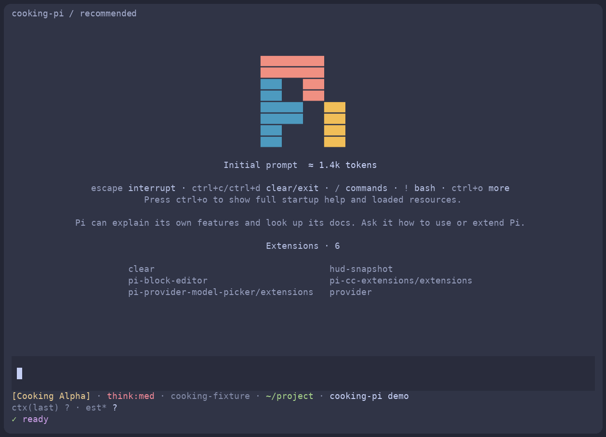

# cooking-pi

Reproducible recipes for a comfortable [Pi](https://github.com/earendil-works/pi) environment: configuration, extensions, workflows, and the reasons behind the choices.

[中文文档](README.md) · [Extension catalogue](docs/extensions.md) · [Compatibility](docs/compatibility.md) · [Discussions](https://github.com/M1racleShih/cooking-pi/discussions)



Rendered from an actual offline Pi terminal session; the demo model and usage data are synthetic.

## Quick start

Use Node **24.18.0** and npm. The lockfile was generated with npm **11.8.0**.

```sh
git clone https://github.com/M1racleShih/cooking-pi.git
cd cooking-pi
npm ci --ignore-scripts
npm run plan
npm run setup
npm run doctor
npm run pi
```

Run `/login` inside Pi to authenticate your own provider, then select a model with `/model` or `Ctrl+L`. Each preset uses a dedicated directory under `~/.local/share/cooking-pi/`; the installer refuses to manage your existing `~/.pi/agent`.

| Preset | Contents |
| --- | --- |
| `minimal` | Native Pi, isolated configuration |
| `recommended` | Catppuccin themes, block editor, HUD, grouped model picker, CC tool rendering, `/clear` |
| `personal` | The author's complete extension combination and optional compatible endpoints |

Select a preset with `--preset minimal` (or `personal`) on every command. Use `--agent-dir /dedicated/directory` or `COOKING_PI_HOME` to change storage. Presets have separate authentication and sessions.

The launcher preserves the caller's working directory. To use it in another project, invoke `node /path/to/cooking-pi/bin/cooking-pi.mjs run`. Pass Pi flags after `--`. Trusted project configuration still applies; a separate configuration directory is not a sandbox.

## Reproduction and ownership

Pi is pinned to **1.2.0**. Exact extension versions, two Git commit archives, and the npm lockfile define the dependency tree. A runtime-only [HUD snapshot](packages/pi-hud-snapshot/README.md) preserves the author's currently uncommitted runtime changes without copying private account configuration. `pi-undo-redo` **0.1.4** includes the merged upstream custom-run fix.

The block editor owns input/header, the HUD owns the footer, and CC owns tool rendering. Duplicate CC header/footer/clear aliases are disabled. Quota queries default off. `personal` additionally includes features that can make extra model or web requests; consult the [catalogue](docs/extensions.md) before enabling it.

`plan` is read-only. `setup` refuses conflicting manual changes unless `--replace` is supplied, and backs up replaced files. `uninstall --dry-run` previews configuration removal; `uninstall` restores originals and retains modified files, credentials, sessions and backups. See [maintenance](docs/maintenance.md).

Linux / Node 24.18.0 is the initial tested baseline. macOS, Windows, desktop IME and clipboard behavior require separate validation. Chinese documentation contains the detailed recipes; English questions and contributions are welcome in [Discussions](https://github.com/M1racleShih/cooking-pi/discussions) and [Issues](https://github.com/M1racleShih/cooking-pi/issues).

MIT. Third-party projects retain their own licences and attribution; see [notices](THIRD_PARTY_NOTICES.md).
