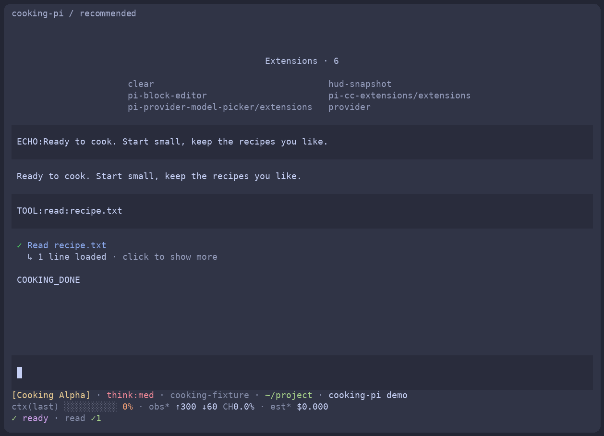

# 扩展配方

可以把这份清单当作选扩展的参考，也可以用仓库工具复现整套组合。直接使用官方 Pi 时，可按[上手指南](getting-started.md)通过 `pi install` 单独安装需要的扩展；各扩展的默认配置可能与这里的配方不同。

以下是首次发布的固定组合。版本升级需要修改依赖清单、更新锁文件并重新验证，启动时不会自动追踪最新版本。`recommended` 和 `personal` 都包含基础界面，`personal` 额外加入工作流工具。

## Pi 与基础界面

| 项目 | 配方 | 作用 |
| --- | --- | --- |
| [Pi](https://github.com/earendil-works/pi) | 全部 | 官方 CLI、工具、会话和模型接口 |
| [pi-block-editor](https://github.com/M1racleShih/pi-block-editor) | recommended / personal | 输入框和欢迎页 |
| [pi-hud](https://github.com/M1racleShih/pi-hud) | recommended / personal | 底栏、上下文和用量展示 |
| [pi-provider-model-picker](https://github.com/M1racleShih/pi-provider-model-picker) | recommended / personal | 按提供商分组选择模型；`/pm`、`Ctrl+L` |
| [pi-cc-extensions](https://github.com/minuque/pi-cc-extensions) | recommended / personal | 工具输出、`/context` 和会话引用 |
| 本仓库 clear | recommended / personal | `/clear` 新建会话，保留模型和思考级别 |

Block Editor 不调用模型。HUD 的额度查询需要显式开启才会联网，配方初始配置为 `enabled: false, profiles: []`。CC 的重复 header、footer 和 `/clear` 别名已关闭，具体分工见下文。

## personal 额外加入的工具

| 项目 | 作用 |
| --- | --- |
| [pi-web-access](https://github.com/nicobailon/pi-web-access) | 搜索、网页访问和内容提取 |
| [pi-undo-redo](https://github.com/Yueby/pi-undo-redo) | 撤销和恢复会话、工作区修改 |
| [pi-codex-compaction](https://github.com/jvm/pi-mono/tree/main/packages/pi-codex-compaction) | 对支持的 Responses 模型进行服务端压缩 |
| [rpiv-todo](https://github.com/juicesharp/rpiv-mono/tree/main/packages/rpiv-todo) | 给模型提供 todo 工具和交互界面 |
| [rpiv-ask-user-question](https://github.com/juicesharp/rpiv-mono/tree/main/packages/rpiv-ask-user-question) | 结构化问题和选项 |
| [pi-goal](https://github.com/narumiruna/pi-extensions/tree/main/packages/pi-goal) | `/goal` 持续推进任务 |
| [pi-fff](https://github.com/dmtrKovalenko/fff/tree/main/packages/pi-fff) | 使用 FFF 搜索文件和内容 |
| [pi-session-titler](https://github.com/M1racleShih/pi-session-titler) | 自动生成会话标题 |
| 本仓库 selected-models | 我的提供商模型目录、参数调整，以及对部分模型的覆盖或隐藏 |

使用前需要了解这些条件：

- 网页搜索和总结需要各自的供应商配置，可能产生额外请求。
- undo-redo 的快照占用磁盘，先在可恢复的练习目录试用。
- 服务端压缩需要对应上游支持，不能用于所有模型。
- goal 的自动回合可能增加模型请求。配方设为最多 60 回合，连续 3 回合无进展时停止。
- FFF 依赖当前平台对应的预编译模块。
- 自动标题在未命名会话首次输入时额外调用模型，默认使用当前模型；`PI_TITLE_OFF=1` 可关闭。
- selected-models 记录个人选择，使用时需核对自己的模型权限与参数。

## 固定版本与来源

下表记录复现组合的版本。完整 Git 提交和依赖完整性保存在 [package.json](../package.json) 与 [package-lock.json](../package-lock.json)；HUD 的逐文件哈希保存在[来源记录](../packages/pi-hud-snapshot/ORIGIN.json)。

| 项目 | 版本或来源 |
| --- | --- |
| Pi | 1.2.0 |
| pi-block-editor | [提交 bb42e1f](https://github.com/M1racleShih/pi-block-editor/commit/bb42e1ff1f55db0c1bf080fe5631a16ca10648c5) |
| pi-hud | [运行源码快照](../packages/pi-hud-snapshot/README.md) |
| pi-provider-model-picker | [提交 94e218d](https://github.com/M1racleShih/pi-provider-model-picker/commit/94e218dd6a14cf43fab0e4fde0e9c9908412cb16) |
| pi-cc-extensions | 1.0.4 |
| 本仓库 clear / selected-models | cooking-pi 0.1.0 |
| pi-web-access | 0.39.0 |
| pi-undo-redo | 0.1.4 |
| pi-codex-compaction | 0.2.3 |
| rpiv-todo / rpiv-ask-user-question | 2.13.8 |
| pi-goal | 0.54.11 |
| pi-fff | 0.11.0 |
| pi-session-titler | 0.1.0 |

## 各扩展负责哪些界面

- Block Editor：输入框和新会话欢迎页。
- HUD：底栏。
- CC：工具输出。`enableAliases`、`enableCustomFooter`、`showStartupHeader`、`enableSubagentAutocomplete` 全部为 false。
- clear：提供本组合唯一的 `/clear` 命令。

增加输入框、页眉、底栏或工具输出扩展前，先确定由哪个扩展负责对应区域，再关闭重复功能。仅调整加载顺序不一定能解决界面冲突。



图中使用离线测试模型驱动真实 Pi 读取练习文件，模型、响应及用量均为合成数据。

## 按需停用

直接使用官方 Pi 时，在终端运行 `pi config`。使用 cooking-pi 的独立配方时，先退出 Pi，再在仓库目录执行对应命令，确保修改的是该配方的配置：

```sh
# recommended
npm run pi -- -- config

# personal
npm run pi -- --preset personal -- config
```

配置界面中可选择启用的资源。也可以在该配方目录的 `settings.json` 中，从 `packages` 移除对应路径，然后在 Pi 内执行 `/reload`。若安装时指定了 `--agent-dir`，配置命令也要带上同一路径。另一种做法是从 `minimal` 配方开始逐项加入。

启动器每次运行时不会重写配置；之后在仓库目录运行 `npm run setup`，工具会对手动修改提示冲突。

生成的包路径指向仓库内的固定依赖。Pi 的扩展更新命令不会更新这份 npm 锁文件；完整配方按[维护流程](maintenance.md)更新。

## 外部集成

Herdr 的状态桥由 Herdr 管理，重新安装或升级集成会覆盖其生成文件。因此本仓库只记录原文件的来源和哈希，接入时引用自己的 Herdr 管理文件。技能需要在自己的目标项目中另行启用。参见[外部集成说明](integrations.md)。
